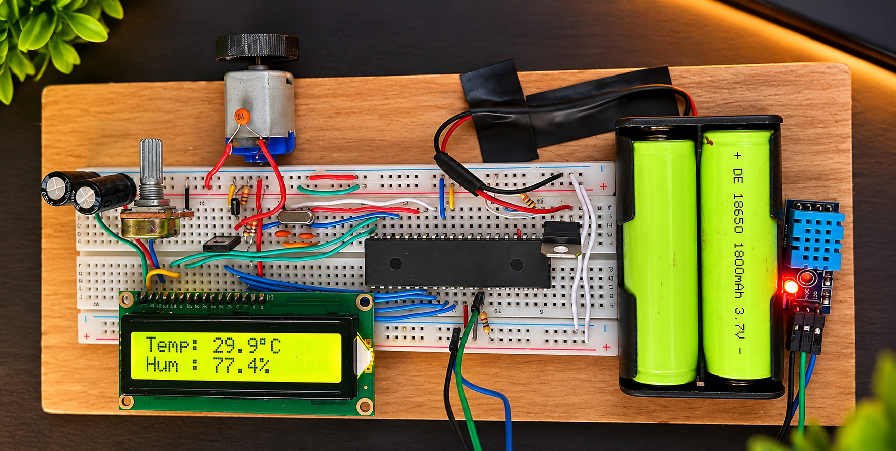

# PIC-Based Temperature and Humidity Monitoring with Automatic Fan Control

## Overview

The **PIC-Based Temperature and Humidity Monitoring with Automatic Fan Control** is an embedded system designed to monitor environmental conditions and automatically operate a DC fan based on the surrounding temperature.

The system uses a **PIC16F877A microcontroller** and a **DHT11 temperature and humidity sensor** to continuously monitor ambient conditions. The measured temperature and humidity values are displayed on a **16×2 LCD using a 4-bit parallel interface**.

When the temperature exceeds **35°C**, the microcontroller activates a DC fan through a MOSFET driver circuit. When the temperature falls to 35°C or below, the fan automatically turns OFF.

This project demonstrates the integration of **sensor interfacing, microcontroller programming, LCD interfacing, digital control, and embedded hardware development**.

## Project Prototype



*Working prototype featuring the PIC16F877A microcontroller, DHT11 sensor, 16×2 LCD, and DC fan.*

## Key Features

- PIC16F877A-based embedded control
- Real-time temperature and humidity monitoring
- DHT11 digital sensor interfacing
- 16×2 LCD with 4-bit parallel communication
- Automatic temperature-based fan control
- MOSFET-based DC fan switching
- Temperature threshold of 35°C
- Sensor data validation using checksum verification
- Breadboard-based hardware implementation

## System Operation

```text
        DHT11 Sensor
     (Temperature & Humidity)
              |
              v
       PIC16F877A
       Microcontroller
          /       \
         v         v
   16x2 LCD    Temperature
   Display      Comparison
                    |
                    v
              Is T > 35°C?
                /     \
              Yes      No
               |        |
               v        v
            Fan ON    Fan OFF
               |
               v
          MOSFET Driver
               |
               v
             DC Fan
```

The DHT11 sensor communicates with the PIC16F877A through a digital data line connected to **RB0**.

The microcontroller processes the received sensor readings and updates the LCD with the measured temperature and relative humidity.

The fan is controlled through **RC2** using a MOSFET switching circuit.

The control logic is:

- **Temperature > 35°C:** Fan ON
- **Temperature ≤ 35°C:** Fan OFF
- **Invalid sensor reading:** Fan OFF

## Technologies Used

- **Microcontroller:** PIC16F877A
- **Programming Language:** Embedded C
- **Temperature & Humidity Sensor:** DHT11
- **Display:** 16×2 Character LCD (4-bit Parallel Mode)
- **Motor Control:** MOSFET-based ON/OFF Switching
- **Actuator:** DC Fan
- **Oscillator:** 10 MHz External Crystal
- **Development Environment:** MPLAB X IDE
- **Compiler:** MPLAB XC8
- **Programmer:** PIC K150

## Hardware Connections

| Component | PIC16F877A Pin |
|---|---|
| DHT11 Data | RB0 (Pin 33) |
| LCD RS | RD0 (Pin 19) |
| LCD Enable | RD1 (Pin 20) |
| LCD D4 | RD4 (Pin 27) |
| LCD D5 | RD5 (Pin 28) |
| LCD D6 | RD6 (Pin 29) |
| LCD D7 | RD7 (Pin 30) |
| Fan Control | RC2 (Pin 17) |

The fan is powered through a MOSFET driver circuit rather than directly from the microcontroller output.

## Applications

This system demonstrates basic environmental monitoring and automatic cooling concepts suitable for:

- Electronic equipment monitoring
- Small enclosure cooling
- Embedded system thermal management
- Temperature-controlled ventilation
- Educational microcontroller applications

## Learning Outcomes

Through this project, the following concepts were explored:

- PIC16F877A microcontroller programming
- Digital temperature and humidity sensor interfacing
- DHT11 single-wire communication protocol
- LCD interfacing using 4-bit parallel communication
- GPIO configuration and control
- MOSFET-based DC load switching
- Temperature-threshold control algorithms
- Sensor data validation and error handling
- Embedded circuit construction and debugging
- Hardware and firmware integration

## Project Status

**Working Breadboard Prototype**

The system has been implemented and tested using a breadboard, demonstrating real-time temperature and humidity monitoring and automatic fan switching based on the programmed temperature threshold.

## Future Improvements

- Adjustable temperature threshold
- Hysteresis-based fan control
- PWM-based variable fan-speed control
- PCB design and enclosure development
- Temperature and humidity data logging
- Remote monitoring capabilities
